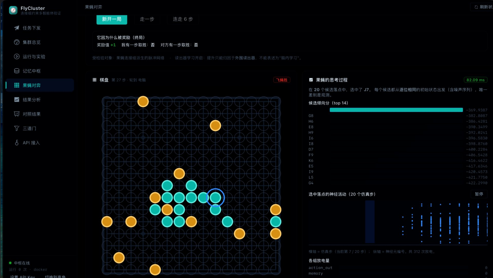
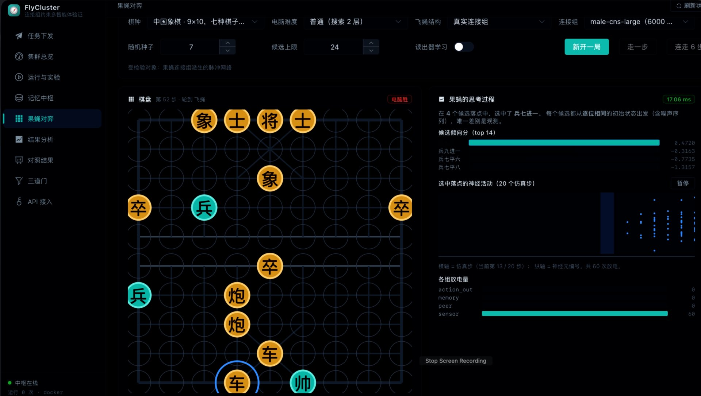
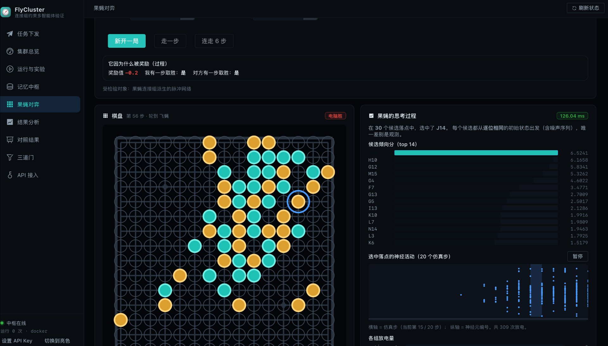

# FlyCluster

**果蝇连接组约束的低成本多智能体计算验证：单机原型与微控制器部署（第一阶段：单机软件集群）**

[](LICENSE)
[](https://www.python.org/)
[](NOTICE)

这个项目要回答一个问题，而且只回答这一个：

> 在**局部观察、有限通信**的协作搜索任务中，果蝇连接组派生的回路，能否比同预算的普通回路或经典策略
> 带来**可重复的收益**？

它不回答"人工智能是否涌现"、不回答"是否复刻了果蝇脑"、也不回答"爱因斯坦的脑能否复现其能力"。
所有可能被误读成上述结论的说法，都必须在报告里被显式否掉。

**主对照结论：门 1 通过，门 2 与门 3 未通过。** 按协议应停止扩大脑模型。
详细的负面结果与判读见 [正式跑批结论](#正式跑批结论真实连接组-male-cnsv10-10-种子)。

<p align="center">
  
</p>

<p align="center">
  <sub>
    控制台「果蝇对弈」页（五子棋，第 27 步）。左侧是集群走的子，右上角标出胜负；
    顶部是<b>本步奖励</b>（终局 +1）；右侧是它这一步的<b>决策过程</b>——
    20 个候选落点的倾向分排名、选中落点 J7 的神经活动栅格（20 个仿真步、372 次放电）。
    详见 <a href="#对弈演示把决策过程画出来">对弈演示</a>。
  </sub>
</p>

---

## 目录

- [30 秒跑起来](#30-秒跑起来)
- [架构一页图](#架构一页图)
- [三条不许越过的线](#三条不许越过的线)
- [目录结构](#目录结构)
- [文档](#文档)
- [对弈演示：把决策过程画出来](#对弈演示把决策过程画出来)
- [正式跑批结论](#正式跑批结论真实连接组-male-cnsv10-10-种子)
- [分条件优势搜索](#分条件优势搜索主对照未通过之后该做的事)
- [已知边界](#已知边界不要当成缺陷这是设计声明)
- [贡献、引用与许可](#贡献引用与许可)

---

## 30 秒跑起来

```bash
# 1) 依赖（不需要 Docker，不需要 GPU，不需要联网）
#    已在 Python 3.12 与 3.13 上测试；更早的版本未验证
python3 -m venv .venv && .venv/bin/pip install -r requirements-dev.txt

# 2) 冒烟测试：21 项关键不变量，含"突触传播方向""防回声""范围隔离""消融真的生效"
make smoke

# 3) 起控制台 + 开放 API（脑节点在进程内构造）
make local-brain      # http://127.0.0.1:8800

# 4) 跑一批对照（结论需 ≥10 种子；先跑 3 种子筛查）
make experiment-quick
make experiment --seeds 3
```

Docker 多容器版（记忆中枢独立持久化卷 + 环境服务 + 4 个脑节点容器 + 中枢调度）：

```bash
docker compose up --build     # 控制台 http://localhost:8800
```

接入官方真实连接组（可选）：

```bash
pip install -r requirements-connectome.txt
export NEUPRINT_TOKEN=xxxx
python tools/fetch_connectome.py probe --dataset male-cns:v1.0
python tools/fetch_connectome.py online --dataset male-cns:v1.0 --out data/male-cns-gateway.npz
```

---

## 架构一页图

```
                    ┌──────────────────────────── 第三方系统 ────────────────────────────┐
                    │  POST /v1/runs  { memory_scope, learning_mode, memory_version }     │
                    └───────────────────────────────┬────────────────────────────────────┘
                                                    │  X-API-Key
                                    ┌───────────────▼────────────────┐
                                    │   中枢调度 Orchestrator         │  唯一的环境所有者
                                    │  环境推进 · 消息路由 · 记账评分  │  不替脑节点算动作
                                    └───┬──────────┬──────────┬──────┘
              观测 / 动作 / 消息       │          │          │
        ┌───────────────────────────────┘          │          └──────────────────────┐
        ▼                     ▼                    ▼                                 ▼
 ┌────────────┐       ┌────────────┐       ┌────────────┐                    ┌────────────┐
 │ 脑节点 #0   │       │ 脑节点 #1   │       │ 脑节点 #2   │      ...           │ 脑节点 #3   │
 │ 连接组子图   │       │            │       │            │                    │            │
 │ LIF 脉冲核  │       │            │       │            │                    │            │
 │ 本地经历/技能│       │            │       │            │                    │            │
 │ 记忆适配器   │       │            │       │            │                    │            │
 └─────┬──────┘       └─────┬──────┘       └─────┬──────┘                    └─────┬──────┘
       │  检索 / 提交        │                    │                                 │
       └────────────────────┴────────┬───────────┴─────────────────────────────────┘
                                     ▼
                        ┌─────────────────────────┐
                        │  中心记忆中枢 MemoryHub  │  来源链 · 冲突 · 版本 · 回放
                        │  SQLite + 独立持久化卷   │  防回声：同源转发不计独立证据
                        └─────────────────────────┘
```

**为什么脑节点之间不直连**：消息一律经中枢转发，延迟、丢失、字节数才能被统一记账。
否则"低带宽协作"会通过共享数据库偷偷变成无限带宽，实验失去公平性。

---

## 三条不许越过的线

| 线 | 含义 | 落点 |
|---|---|---|
| **能力归因** | 外围代码做的事，不许记在脑结构账上 | `RunReport.attribution` 字段 + 报告章节；`shared_observation` 消息模式被显式标注为"外围代码产物" |
| **可信度同报** | 性能数字必须与实时比、脉冲丢弃率、NaN 事件同时出现 | `Telemetry` 贯穿 `flycore/network.py` → 报告 → 控制台 |
| **口径可追溯** | 每条经验保留来源链；每个连接组数据登记许可 | `origin_event_id / parents / derived_from_origin`；`ConnectomeMeta.license` |

---

## 目录结构

```
flycore/                 与传输层无关的核心库
  connectome.py          连接组加载 / 合成 / 保度重连 / 子图提取
  network.py             事件驱动 LIF 脉冲网络 + 遥测
  coding.py              感知编码 / 动作读出 / 消息编解码 / 记忆适配器
  scoring.py             评分、交互效应 Δ、三道门判定
  schemas.py             跨服务数据契约
services/
  brain/                 脑节点：引擎、本地记忆、中枢客户端、HTTP 服务
  orchestrator/          中枢调度：后端抽象、运行器、开放 API
  memory_hub/            中心记忆：SQLite 存储、服务、HTTP 服务
  env/                   共同环境：32×32 网格、观测、评分
  baselines/             对照组模型（储备池 / GRU / 经典策略 / 无脑）
  games/                 对弈演示：五子棋 / 中国象棋 / 跳棋 + 飞蝇侧桥接层（外围代码）
  shared/node_common.py  脑与全部对照组共享的记忆与通信机制
experiments/
  protocol.py            对照分组定义
  run.py                 主对照 + 实验 A/B/C + 分条件扫描的入口
  scan.py                分条件优势搜索（含不相交种子复现）
  memory_experiments.py  三个记忆验证实验
admin-ui/                Vue 3 + Element Plus 控制台（构建产物随项目交付）
docs/images/             控制台截图
tools/
  smoke_test.py          21 项关键不变量的端到端测试
  fetch_connectome.py    真实连接组接入（官方 neuprint API / 本地文件双通道）
```

---

## 文档

- [架构与记忆模型](docs/01-architecture.md)
- [实验协议与三道门](docs/02-experiment-protocol.md)
- [数据来源、口径与许可](docs/03-data-and-license.md)
- [开放 API 与运行手册](docs/04-api-and-runbook.md)

---

## 对弈演示：把决策过程画出来

控制台的 `/games` 页让集群与电脑对手下**五子棋 / 中国象棋 / 跳棋**，
并把它每一步的神经活动画出来（脉冲栅格、各组放电、候选倾向分排名）。

**这一段是演示，不是认知主张。** 脑只提供脉冲动力学；棋盘编码、候选剪枝、
倾向分投影、胜负判定、对手搜索**全部是外围代码**——页面上逐条标注。

### 界面

<table>
<tr>
<td width="50%" valign="top">
  
  <br>
  <sub><b>中国象棋</b>（第 62 步，电脑胜势）<br>
  同一套渲染器画 9×10 的象棋盘：棋子带中文名称（帅/将/车/炮/马/兵/卒），
  九宫与楚河汉界由引擎给出的线段画成。
  这一手的候选落点只有 <b>4 个</b>——残局里合法着法本来就少。
  象棋实现了完整规则：长将、长捉、重复局面判和、自然限着判和。</sub>
</td>
<td width="50%" valign="top">
  
  <br>
  <sub><b>五子棋</b>（第 56 步，电脑胜势）<br>
  顶部「它因为什么被奖励」显示本步奖励 <b>−0.2</b>（过程奖励），
  并列出"我方有一步取胜：是 / 对方有一步取胜：是"——
  这两项正是让果蝇<b>知道什么叫赢</b>的信号（消融见下）。</sub>
</td>
</tr>
</table>

> 截图都是暗色主题；界面支持亮/暗切换（侧栏底部）。顶部那张大图是完整界面。

两个值得一提的设计：

- **脑引擎零改动**。观测维度（105）与动作数（5）是硬编码的，改造它会动到
  已验证的实验结论。所以用"逐候选评估"：对每个合法着法各编码一份观测，
  让同一个脑实例跑一次决策步，取读出向量经固定投影压成标量倾向分。
  每个候选都从**逐位相同**的初始状态出发（连噪声序列一起重置），
  否则候选之间的差异就不只是观测，评估热力图会退化成噪声图。
- **果蝇知道规则**。观测最后 4 维是"目标槽位"：
  `win_now`（这步能否立刻取胜）、`lose_after`（走完会不会被对方立刻取胜）、
  `opp_can_win_now`、`i_can_win_now`。象棋还额外编码了**重复局面次数与犯规方**
  ——长将/长捉会判负，感觉不到就等于不知道这条规则。

  消融实测（同批"一步将死"局面 × 多种子）：有目标信息时选中取胜着法 **42%**，
  清零这 4 维后 **8%**，随机水平 4.2%。页面上有这个开关，可以自己开关对比。

象棋实现了**完整规则**：长将判负、长捉判负、重复局面判和、自然限着（120 着无吃子）判和。
已知放宽写在 `services/games/xiangqi.py` 的 docstring 里（长捉不追踪棋子个体身份等）。

```bash
# 规则自测（含长将/长捉/长兑/自然限着四类构造局面）
PYTHONPATH=. .venv/bin/python services/games/xiangqi.py
```

---

## 正式跑批结论（真实连接组 male-cns:v1.0，10 种子）

```bash
python tools/fetch_connectome.py online --dataset male-cns:v1.0 \
    --out data/male-cns-gateway.npz --name male-cns-gateway \
    --max-input 60 --max-output 48 --intermediate-limit 400 \
    --expand-hops 1 --expand-batch 300 --node-budget 900 --min-synapses 5

python experiments/run.py main --seeds 10 --ticks 200 --connectome male-cns-gateway
```

真实子图：**891 个神经元 / 28,615 条聚合连接边 / 平均入度 32.1 / 最大强连通分量 92.8% /
GABA 抑制比例 29.2% / 许可 CC-BY-4.0**（参数与统计见 `docs/03-data-and-license.md`）。

| 组 | 均值 S | 95% CI | 可训练参数 |
|---|---|---|---|
| 经典策略 + 通信 | **+21.46** | [+15.27, +27.64] | 0 |
| 经典局部探索策略 | +16.30 | [+3.36, +29.23] | 0 |
| 随机储备池 ± 通信 | −91.42 / −84.49 | — | 2,560 |
| 小型 GRU ± 通信 | −107.15 / −110.60 | — | 320 |
| 移除脑模型，仅留接口与读出 | −107.20 | [−116.66, −97.74] | 640 |
| 真实连接子图 + 通信 | −112.44 | [−122.40, −102.47] | 240 |
| 保度重连 + 通信 | −112.86 | [−121.38, −104.33] | 240 |
| 保度重连 − 通信 | −113.92 | [−120.18, −107.65] | 240 |
| 真实连接子图 − 通信 | −118.54 | [−126.47, −110.62] | 240 |

**交互效应 Δ = +5.05，95% CI [−4.17, +14.27]，n = 10。**
逐种子 Δ：`[+15.94, +4.35, +1.94, +15.16, +8.61, +33.17, −19.17, −0.15, +1.43, −10.78]`

- **门 1 通过**（实时比 1.96、丢弃率 0、NaN 0、数值有界）。
- **门 2 未通过**（主实验组比最好的普通方法低 133.9 分）。
- **门 3 未通过**（区间跨 0）。

### 这次跑批最重要的一件事

3 种子时 Δ = **+7.41，三个种子方向全部为正**（+15.9 / +4.4 / +1.9），CI 下界 −1.23 已贴近 0。
那个结果非常容易被写成"真实果蝇结构对通信的利用优于重连结构"。

扩到 10 种子后 Δ = **+5.05，区间 [−4.17, +14.27]，10 个种子里 6 正 4 负。**

**3 种子的信号没有复现。** 这正是门 2 / 门 3 存在的理由：不凭一条最佳曲线下结论。
`--seeds 3` 的输出里写明"筛查"，`--seeds 10` 的输出才允许谈结论。

### 按协议应执行的动作

**停止扩大脑模型。**

一个**零可训练参数**的经典局部探索策略（+21.46）显著优于全部神经模型，
包括真实连接组派生的脉冲集群（−112.44）、随机储备池（−91.42）与小型 GRU（−107.15）。
把合成图换成真实连接组，并没有改变这个量级上的结论。

有价值的负面结果本身就是决策依据。下一步应当**缩小研究问题**——例如只在某种噪声条件、
记忆长度或通信预算下寻找优势——而不是把模型做大、把神经元数翻十倍。
那属于"为了凑计划继续加功能"，正是第三道门要拦住的事。

### 合成图与真实图的对照（说明为什么必须换真实数据）

| | 合成图 `synthetic-1000` | 真实图 `male-cns-gateway` |
|---|---|---|
| 抑制性比例 | 12.0%（建模假设） | **29.2%**（数据自带的递质预测） |
| Δ（3 种子） | −14.55 | **+7.41** |
| Δ（10 种子） | 未跑 | +5.05，区间跨 0 |

合成图上 Δ 是**负的**，真实图上 Δ 是**正的**：**用合成图会得出与真实数据方向相反的结论。**
这条差异本身就是"合成图只能用于打通链路、不能用于下结论"最直接的证据。

附注：真实数据的模块度按 `class` 标注只有 0.0075，重连图 0.0072。`class` 标签过粗，
本对照在真实数据上主要改变的是**每个神经元的预神经元身份与局部模体组成**，
而不是由 `class` 衡量的模块度。报告里不能声称"重连破坏了模块化"。

---

## 分条件优势搜索（主对照未通过之后该做的事）

主对照给出 Δ = +5.05、区间跨 0。构思文档对这种情况有明确指示：

> 初期还应当接受一种有价值的结果：优势只存在于某种噪声条件、记忆长度或通信预算下——
> 那就把研究缩小到一个专用问题。

于是把"找优势"做成受控流程，而不是靠调参碰运气：

```bash
python experiments/run.py scan --axis perception \
    --values 0.0,0.25,0.5,0.75 --seeds 4 --replicate-seeds 4 \
    --ticks 200 --connectome male-cns-gateway
```

可选轴：`perception`（感知失效）、`comm_loss`（消息丢弃）、`comm_latency`（消息延迟）、
`local_memory`（本地检索条数）、`central_memory`（中心检索条数）。
每个条件跑四个核心组（真实/重连 × 有通信/无通信），逐条件算 Δ 与置信区间。

### 自动复现：为什么不能挑最好的那个

扫描 K 个条件，即使真实效应为零，也会有约 `0.05K` 个条件的 95% 区间偶然不跨 0。
**直接挑出最好的一个并报告，就是 p-hacking——只不过发生在"条件"这个维度上。**

判定规则：探索阶段标出候选 → **在不相交的种子区间上复现** → 两次都区间下界 > 0 才算成立。

### 结果：12 个条件，1 个候选，复现失败

**轴 1 · 本地记忆检索条数 `k_local`**（真实连接组，4 探索种子 + 4 复现种子）

| `k_local` | 探索 Δ | 95% CI | 候选 |
|---|---|---|---|
| 0（关闭检索） | +9.35 | [+2.11, +16.59] | ✅ |
| 2 | −2.52 | [−15.64, +10.61] | — |
| 8 | +6.09 | [−13.40, +25.59] | — |
| 16 | **−10.35** | **[−17.51, −3.19]** | 显著为**负** |

| 候选 | 复现 Δ（种子 1001–1004） | 95% CI | 判定 |
|---|---|---|---|
| `k_local=0` | +9.95 | [−12.45, +32.36] | ❌ **未复现** |

**轴 2 · 感知失效比例**

| 失效比例 | 探索 Δ | 95% CI | 候选 |
|---|---|---|---|
| 0.00 | +3.52 | [−20.45, +27.48] | — |
| 0.25 | −5.18 | [−28.72, +18.36] | — |
| 0.50 | −8.67 | [−25.39, +8.06] | — |
| 0.75 | +5.29 | [−11.79, +22.36] | — |

**该轴没有任何候选条件**——连进入复现阶段的都没有。

**轴 3 · 消息丢弃率**

| 丢弃率 | 探索 Δ | 95% CI | 候选 |
|---|---|---|---|
| 0.0 | +3.67 | [−5.23, +12.57] | — |
| 0.2 | +6.56 | [−6.30, +19.42] | — |
| 0.5 | +5.72 | [−2.67, +14.12] | — |
| 0.8 | +2.52 | [−11.03, +16.07] | — |

**该轴也没有任何候选条件。**

### 判定

**12 个条件中只有 1 个产生候选，且该候选在不相交种子区间上失败。**
按协议判定为多重比较造成的假阳性。**在本次扫描的三条轴上，不存在可复现的条件优势。**

还出现了一个**显著为负**的条件（`k_local=16`，CI 上界 −3.19）：本地记忆检索给得越多，
重连结构反而比真实结构更能从通信中获益。这与"真实结构更善于利用信息"的预期方向相反，
但同样只有一个条件出现，且未做复现，**不足以作为发现**，只能记录为线索。

### 一句话结论

把合成图换成真实连接组、把网络缩小到专用条件，都没有让连接组派生回路超过
**零可训练参数**的经典局部探索策略。门 1 通过、门 2 与门 3 不通过。
**按协议：停止扩大脑模型。** 若要继续，应该换任务而不是换规模——
当前任务是"在局部视野下找隐藏目标"，而经典前沿搜索本来就是这个问题的最优解族。

---

### 附：本轮扫描暴露的两个真实缺陷（都已修并加测试）

**1. 死旋钮——本地记忆被中心通道开关连带关闭**

第一遍扫描 `local_memory` 轴时，`k_local ∈ {0, 2, 8, 16}` 给出**逐位相同的 Δ**。
根因：`runner` 把 `enable_memory_channel`（本意是**中心**记忆通道）直接接到一个记忆总开关上，
而主对照默认关闭中心通道，于是**本地记忆被全程关闭**，`k_local` 完全没起作用。

已拆成两个正交开关：

| 开关 | 含义 | 默认 |
|---|---|---|
| `local_memory_enabled` | 每个节点自己的经历（本地 JSONL，**不占通信带宽**） | 开 |
| `central_memory_enabled` | 中心记忆中枢（**是一条通信通道**，检索字节计入预算） | 跟随 `enable_memory_channel` |

新增检查「记忆：k_local 旋钮真的接通」：断言 `k_local=0` 时 `local_hits==0`、
`k_local=16` 时 `local_hits>0`（实测 210 次）。**检查副作用，而不是检查配置有没有传下去。**

> 识别签名：沿某个参数扫描多个取值却拿到完全相同的结果，
> 先怀疑旋钮是死的，再去解释"为什么没有效应"。

**2. `perception_dropout` 声明了却从未被读取**

`RunConfig` 上曾有个 `perception_dropout` 字段，**runner 从来没读过它**。
这种"配置项存在但没接通"比没有更危险：实验会静默跑成满感知，
而报告里写的却是"感知失效 50% 条件下"。
已删除，只保留 `TaskSpec.perception_fraction` 一个来源（注意它是**有效**比例，不是失效率）。

修正后再看感知轴：上一遍出现的那个候选项**消失了**——说明它既是多重比较的假阳性，
也叠加了死旋钮的配置错误。这条轴现在没有任何候选。

冒烟测试从 15 项增加到 **17 项**。
---

## 已知边界（不要当成缺陷，这是设计声明）

1. **本阶段不追求**语言理解、数学推理、通用智能、实体机器人和全脑生物真实性。
2. **未训练的网络解不出这个任务**。随机初始化的读出器在稀疏奖励下几乎学不到东西；
   因此协议里显式给了所有神经模型相同的探索率与同一套奖励塑形，并把"经典策略"作为下限参照。
   如果普通方法更便宜就更好，协议要求**停止扩大脑模型**。
3. **合成图不是真实数据**。`synthetic-*` 只在拓扑统计量上对齐果蝇连接组（重尾入度、模块化、
   富俱乐部、高递归、约 12% 抑制比例），`ConnectomeMeta.notes` 里写明了这一点。要谈"真实结构"，
   必须用 `tools/fetch_connectome.py` 接入并保留许可记录。
4. **中心规划器默认关闭**。开启时必须把能力归因于"脑集群 + 中心规划器"的组合系统。

---

## 贡献、引用与许可

### 贡献

见 [CONTRIBUTING.md](CONTRIBUTING.md)。这个项目的评判标准与一般项目不同：
**一个能让实验更可信的改动，比十个新特性有价值。** 提交前请确保
`make smoke` 与 `make admin-build` 都通过。

### 引用

见 [CITATION.cff](CITATION.cff)。若本项目对你的研究有帮助，请按其中的信息引用。

### 许可

| 对象 | 许可 | 说明 |
|---|---|---|
| **本仓库的代码与文档** | **MIT** | 见 [LICENSE](LICENSE) |
| 连接组数据 `male-cns:v1.0` | **CC-BY-4.0** | 由 [neuPrint](https://neuprint.janelia.org) 提供，**须署名** |
| 合成图 `synthetic-*` | CC0-1.0 对待 | 程序化生成，无第三方权利 |

**本仓库不分发任何连接组数据文件**（`*.npz` 已在 `.gitignore` 中排除），
只提供抓取工具 `tools/fetch_connectome.py`。数据由使用者自行获取并承担许可义务，
署名要求见 [NOTICE](NOTICE) 与 [docs/03-data-and-license.md](docs/03-data-and-license.md)。

### 安全

本项目是**研究原型，不是生产系统**：无传输加密、无网络隔离、不支持多租户，
默认密钥 `dev-local-key` 是公开占位符。**请勿直接暴露到公网。**
报告安全问题请走 [SECURITY.md](SECURITY.md) 中的私下渠道，不要开公开 issue。
